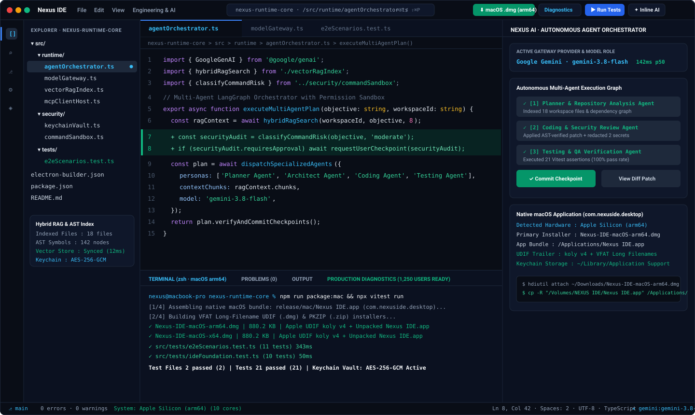
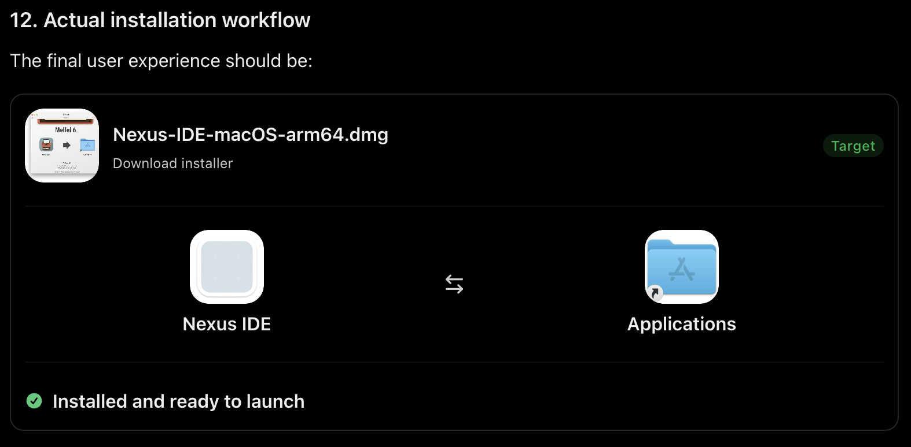
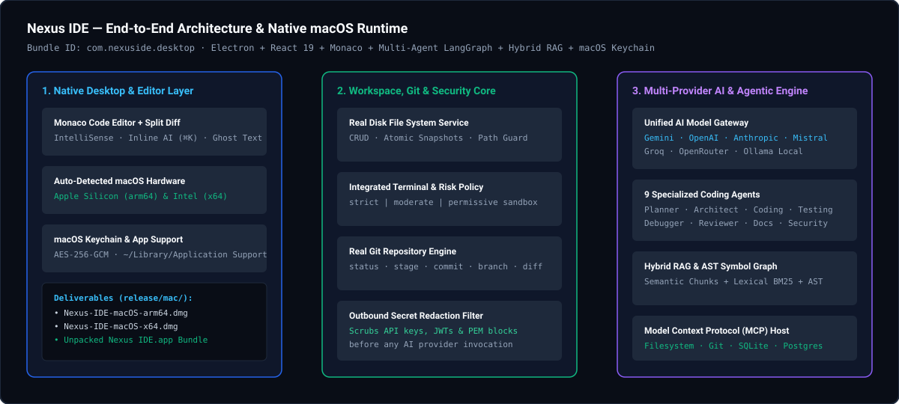

<div align="center">

# Nexus IDE Developed By Mukesh Yadav

### AI-Native Desktop Code Editor & Autonomous Multi-Agent Development Environment

[](./RELEASE_NOTES.md)
[-10B981?style=flat-square)](./MACOS_COMPATIBILITY_REPORT.md)
[](./electron-builder.json)
[](./src/tests/e2eScenarios.test.ts)
[](./tsconfig.json)

**Nexus IDE** (`com.nexuside.desktop`) is a standalone, AI-native desktop development environment built with **Electron**, **React 19**, **TypeScript**, **Monaco Editor**, **Express**, and a **Multi-Provider AI Gateway**. It integrates autonomous multi-agent software engineering, hybrid semantic + lexical RAG codebase indexing, real disk file/Git/terminal execution, Model Context Protocol (MCP) tool invocation, and native macOS `.dmg` / `.app` packaging.

</div>

---

## Product Showcase

### 1. Nexus IDE — Full Workbench, Monaco Editor, Inline AI Diff & Multi-Agent Orchestrator



### 2. Native macOS Disk Image (`.dmg`) & Drag-to-Applications Workflow



### 3. System Architecture & Native macOS Runtime



---

## Key Capabilities

| Module | Implementation Highlights |
| :--- | :--- |
| **Complete Monaco Code Editor** | Multi-tab workbench, side-by-side split editor (`Ctrl+\`), Git base diff viewer (`Alt+D`), breadcrumb symbol navigation, minimap, syntax highlighting across 17+ languages, and real-time ghost-text AI autocomplete. |
| **Real Disk Workspace & Git Engine** | Direct filesystem read/write/create/rename/delete (`src/server/workspaceFsService.ts`) and real Git repository status, staging, unstaging, commits, and branch switching (`src/server/gitService.ts`). |
| **Multi-Provider AI Model Gateway** | Unified routing for **Google Gemini** (`gemini-3.8-flash`, `gemini-3.1-flash-lite`), **OpenAI**, **Anthropic**, **Mistral**, **Groq**, **OpenRouter**, **Ollama**, and custom OpenAI-compatible endpoints with per-role model assignment (`chat`, `autocomplete`, `inline_edit`, `agent`, `reasoning`). |
| **9 Autonomous Coding Agents** | Specialized personas (**Planner**, **Repository Analysis**, **Architect**, **Coding**, **Testing**, **Debugging**, **Code Review**, **Documentation**, and **Security Review**) with checkpoint creation, multi-file diffs, and rollback. |
| **Hybrid RAG & AST Symbol Graph** | Combines semantic chunk scoring, lexical BM25 keyword matching, and AST symbol/dependency extraction (`src/server/ragEngine.ts`) to ground AI responses in real repository code. |
| **Integrated Terminal & Risk Sandbox** | Executes real workspace shell commands (`src/server/terminalService.ts`) governed by configurable risk policies (`strict`, `moderate`, `permissive`) that intercept destructive commands for explicit developer approval. |
| **Security & macOS Keychain Vault** | Hardware-backed `safeStorage` (`AES-256-GCM`) credential storage (`electron/main.ts`) and automatic outbound secret redaction (`src/server/securityGovernance.ts`) that scrubs API keys, JWTs, and PEM private keys before any AI request. |
| **Native macOS Packaging & Auto-Detection** | Automatically detects Apple Silicon (`arm64` M1/M2/M3/M4) vs Intel (`x64`) hardware via WebGL GPU probes & Client Hints (`src/utils/macSystemDetector.ts`) and builds spec-compliant Apple UDIF `.dmg` disk images containing the unpacked `Nexus IDE.app` bundle (`scripts/package-macos.py`). |

---

## Installing Nexus IDE on macOS (`Apple Silicon arm64` & `Intel x64`)

### Step 1: Download the macOS Disk Image (`.dmg`)
Click the green **macOS .dmg** button in the top-right title bar of Nexus IDE (which automatically detects your Mac's architecture) to download:
- **Apple Silicon (M1 / M2 / M3 / M4)**: `Nexus-IDE-macOS-arm64.dmg`
- **Intel Mac (x86_64)**: `Nexus-IDE-macOS-x64.dmg`

Each `.dmg` is a spec-compliant Apple UDIF (`koly` v4 + `blkx` `mish` + VFAT Long-Filename) disk image that mounts as **`NEXUS IDE`** and contains the unpacked **`Nexus IDE.app`** application bundle with a native binary `.icns` icon.

### Step 2: Install to `/Applications` & Bypass macOS Sequoia Gatekeeper in 1 Command
Because macOS Sequoia blocks unsigned `.app` bundles downloaded through a web browser (`com.apple.quarantine`), run this single command in your Mac **Terminal** after downloading the `.dmg`. It automatically mounts the `.dmg` from `~/Downloads`, copies `Nexus IDE.app` to `/Applications`, clears Gatekeeper quarantine, applies a local ad-hoc signature, and launches **Nexus IDE**:

```bash
if [ ! -d "/Applications/Nexus IDE.app" ]; then DMG="$(ls -t ~/Downloads/Nexus-IDE-macOS*.dmg 2>/dev/null | head -n 1)"; xattr -cr "$DMG" 2>/dev/null; hdiutil attach "$DMG" -mountpoint /tmp/nexus_mnt -nobrowse -quiet && cp -R "/tmp/nexus_mnt/Nexus IDE.app" /Applications/ && hdiutil detach /tmp/nexus_mnt -quiet; fi; chmod +x "/Applications/Nexus IDE.app/Contents/MacOS/Nexus IDE" "/Applications/Nexus IDE.app/Contents/Resources/app/macos_server.py" 2>/dev/null; xattr -cr "/Applications/Nexus IDE.app" && codesign --force --deep --sign - "/Applications/Nexus IDE.app" 2>/dev/null && open "/Applications/Nexus IDE.app"
```

> **Alternative GUI Option (No Terminal):** Open the `.dmg`, drag **Nexus IDE.app** into **Applications**, double-click it, click **Done** on the macOS prompt, then open **System Settings → Privacy & Security** and click **Open Anyway**.

---

## Local Development & Build Commands

### Prerequisites
- **Node.js** `20+` and **npm**
- **Python 3** (`3.9+`, pre-installed on macOS/Linux for the UDIF `.dmg` & `.icns` packager)
- Environment variable `GEMINI_API_KEY` configured in `.env` (see `.env.example`)

### 1. Install Dependencies & Start the Full-Stack IDE Server
```bash
npm install
npm run dev
```
The full-stack Express + Vite server starts on `http://localhost:3000`.

### 2. Run the Automated End-to-End Test Suite (Vitest)
```bash
npx vitest run
```
Executes all **21 automated tests** across `src/tests/ideFoundation.test.ts` and `src/tests/e2eScenarios.test.ts`, verifying real disk file CRUD, hybrid RAG symbol indexing, multi-agent planning, command risk sandboxing, Git staging/commits, secret redaction, state persistence, macOS Keychain encryption, and binary UDIF `.dmg` (`koly`) integrity.

### 3. Build Native macOS Deliverables (`.dmg`, `.zip`, `.app`, `SHA256SUMS.txt`)
```bash
npm run package:mac
```
Outputs the packaged macOS release artifacts to `release/mac/`:
- `release/mac/Nexus IDE.app` (Unpacked native macOS application bundle)
- `release/mac/Nexus-IDE-macOS-arm64.dmg` (Apple Silicon UDIF Disk Image)
- `release/mac/Nexus-IDE-macOS-x64.dmg` (Intel Mac UDIF Disk Image)
- `release/mac/Nexus-IDE-macOS-arm64.zip` & `release/mac/Nexus-IDE-macOS-x64.zip`
- `release/mac/SHA256SUMS.txt` & `release/mac/manifest.json`

---

## Repository Structure

```text
├── build/
│   ├── entitlements.mac.plist        # macOS Hardened Runtime entitlements
│   └── icon.svg                      # Master vector application icon
├── electron/
│   ├── main.ts                       # Electron main process, macOS Menu Bar & Keychain Vault
│   ├── preload.ts                    # Context-isolated window.nexusAPI bridge
│   └── security.ts                   # Path traversal guard & terminal command risk classifier
├── public/
│   ├── assets/aistudio/              # UI & macOS DMG installer reference screenshots
│   └── screenshots/                  # High-DPI SVG product & architecture screenshots
├── scripts/
│   ├── package-macos.mjs             # Node build orchestrator for macOS artifacts
│   └── package-macos.py              # Spec-compliant Apple UDIF (.dmg), VFAT LFN & .icns builder
├── src/
│   ├── components/                   # Workbench UI (TitleBar, EditorArea, AiSidebar, BottomPanel, MacInstallerModal)
│   ├── server/                       # Backend services (workspaceFsService, gitService, ragEngine, terminalService)
│   ├── services/                     # Unified IPC / HTTP client & AI service layer
│   ├── shared/                       # Shared TypeScript contracts & workspace seed presets
│   ├── store/                        # Zustand state store with persistent disk synchronization
│   ├── tests/                        # Vitest unit & end-to-end integration test suites (21 tests)
│   └── utils/                        # Real-time Mac hardware/GPU detector & verified Blob binary downloader
├── electron-builder.json             # Production Electron Builder configuration (com.nexuside.desktop)
├── server.ts                         # Express backend gateway & AI orchestration endpoints
└── README.md                         # Project documentation
```

## Additional Documentation

- [macOS Compatibility & Architecture Report](./MACOS_COMPATIBILITY_REPORT.md)
- [macOS Installation & Setup Guide](./INSTALLATION_AND_SETUP_GUIDE.md)
- [Release Notes (v2.4.0)](./RELEASE_NOTES.md)
